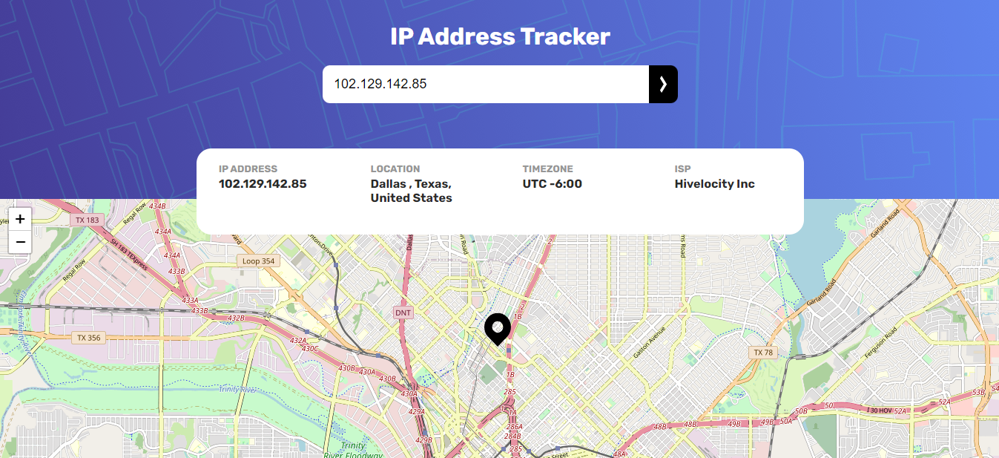

# IP Address Tracker

My solution to the Frontend Mentor IP Address Tracker challenge: look up any IP address and see its location on an interactive map.

**Live demo:** https://ip-address-tracker-three-alpha.vercel.app/

<p>
  
</p>

## Features

- Search any IP address
- IP, location, timezone and ISP displayed in a summary bar
- Interactive Leaflet map centred on the result
- Responsive layout matching the Frontend Mentor design

## Tech stack

- HTML5
- CSS3 (Flexbox)
- Vanilla JavaScript
- Leaflet.js
- IP Geolocation API (ipgeolocation.io)

## Getting started

No build step. Open `index.html` in a browser, or serve the folder:

```bash
npx serve .
```

## Credits

Challenge by [Frontend Mentor](https://www.frontendmentor.io/challenges/ip-address-tracker-I8-0yYAH0).


## Author

**Muhammad Kabir Kaka**, Frontend Engineer (React · Next.js · TypeScript)  
[GitHub](https://github.com/KabirKaka) · [LinkedIn](https://www.linkedin.com/in/muhammad-kabir-kaka)
